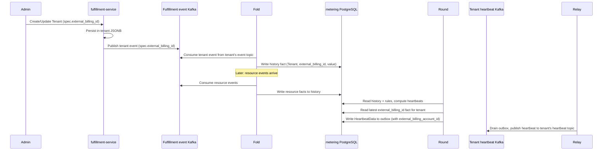

# Tenant External Billing Identity

## Summary

Add an optional, opaque `external_billing_id` to private `TenantSpec`, set through the private Fulfillment API, and have the metering Fold read it from the tenant and store it in the `progress` table so each `HeartbeatData` the Round publishes carries the external billing account identifier. See [PRD](prd.md) for requirements.

## Motivation

OSAC meters tenant consumption and publishes heartbeats to a per-tenant Kafka topic. Downstream billing adapters route those heartbeats using their own account identifiers, which are unrelated to OSAC tenant names. `TenantSpec` has no field for that identifier, and `HeartbeatData` carries only the OSAC `tenant_id`.

This design stores the identifier on the private tenant. The metering Fold reads it from the tenant event the existing event stream already delivers and records it in `history`; the Round reads the latest fact and carries it into every `HeartbeatData` it writes.

### Goals

- Add optional `external_billing_id` to private `TenantSpec`, set and read through the private Fulfillment API. [Locked: D2]
- Keep the field out of the generated public schema. [PRD: FR-2]
- Set `HeartbeatData.external_billing_account_id` by reading the latest `external_billing_id` fact the Fold writes to `history` from the tenant event stream. [User]
- Apply billing-id changes to later heartbeats only. [PRD: FR-4]
- Store the field in the existing tenant JSONB document. No SQL migration in fulfillment-service or metering.

### Non-Goals

- Console UI, Enclave Wizard, or CLI changes. The field rides the existing tenant manifest, including `osac create -f`. [Locked: D2, D4]
- More than one external billing account per tenant, or a uniqueness constraint.
- Checking that the identifier exists in the external billing system.
- Rewriting heartbeats already published to the tenant's heartbeat Kafka topic.

## Proposal

Two components change. The private Fulfillment API gains `TenantSpec.external_billing_id`. The metering Fold reads that value from the tenant event it already consumes and writes it as a fact to `history`; the Round reads the latest fact and sets `HeartbeatData.external_billing_account_id`.

`[(cleanapi.field).private = true]` makes `protoc-gen-cleanapi` omit the field from the public proto. When a tenant Create or Update event arrives on the tenant's event topic, the Fold extracts `spec.external_billing_id` and writes a `history` fact for it. The Round reads the latest `external_billing_id` fact for the tenant when it builds each heartbeat. [User]

### Workflow Description

A Cloud Provider Admin sets `spec.external_billing_id` on create or update of a tenant through the private API (`/api/private/v1/tenants`). The field is optional, at most 256 characters, and has no format check. Private Get and List return it when set. Public Get and List do not define it. [Locked: D2, D3]

`PrivateTenantsServer` uses full object replacement: an Update request replaces the entire `TenantSpec`. Omitting `external_billing_id` from an Update request clears the stored value; setting it to a new value stores that value. A caller that wants to preserve the existing value while changing other fields must re-send `external_billing_id` in the request.

After the value is stored, the metering pipeline propagates it to heartbeats:



The `tenants` table has the same `enqueue_change` trigger as every other object table, so creating or updating a tenant publishes an event carrying the full `TenantSpec` to the tenant's own event topic — the same topic the Fold already consumes. When the Fold encounters a Tenant event, it extracts `spec.external_billing_id` and writes a `history` fact for `(tenant, "Tenant", tenant, "external_billing_id", event_timestamp, value, offset)`. If the tenant has no `external_billing_id`, it writes an empty value, signaling no billing id is set. The Round reads the latest `external_billing_id` fact for each tenant when it builds a heartbeat and sets `HeartbeatData.external_billing_account_id` when the value is non-empty.

A billing-id change takes effect in the next fold run that processes events for that tenant. Outbox entries already written by the Round are immutable; the Round does not update them after a billing-id change. The first Round tick after the Fold updates `progress` will produce new outbox entries carrying the new id, and the Relay will publish those. Heartbeats already published to the tenant's heartbeat topic stay as they were. [PRD: FR-4]

### API Extensions

- **Private `TenantSpec.external_billing_id`.** Optional string on the existing tenant resource. Create, Update, Get, and List on `/api/private/v1/tenants` gain the field. The public tenant messages are unchanged because `proto/public/` is generated.
- **`HeartbeatData.external_billing_account_id`.** Optional JSON field on the metering heartbeat payload. Present when the latest `external_billing_id` history fact for that tenant is non-empty. Absent when it is not.

## UX Alignment

No UI mapping. The field is private, and console UI is out of scope. [Locked: D2]

### Implementation Details/Notes/Constraints

Add field 3 on `TenantSpec` in `proto/private/osac/private/v1/tenant_type.proto`, after the existing public fields:

```protobuf
message TenantSpec {
  repeated string domains = 1;
  SecretLocalReference break_glass_credentials_secret = 2;

  // Opaque identifier for this tenant's account in the external billing
  // system. Optional. Provider-controlled. Omitted from the public API.
  optional string external_billing_id = 3
    [(cleanapi.field).private = true,
     (buf.validate.field).string.max_len = 256];
}
```

Regenerate with `make -C proto generate` and lint with `buf lint`. Do not edit `proto/public/`.

`PrivateTenantsServer` persists the proto as JSONB through `GenericServer` and `GenericDAO`. No server change and no SQL migration. The public `GenericMapper` copies fields by name; the generated public `TenantSpec` has no `external_billing_id`, so the value is never copied to a public response. The existing protovalidate interceptor enforces the 256-character limit on Create and Update.

The field rides the event stream automatically with no further fulfillment changes. The `enqueue_change` trigger copies the full tenant row as JSONB into the `changes` table on every write. The event publisher's `protojson.Unmarshal` call unmarshals the entire JSONB blob into the proto message in one shot — any field present on the proto rides the Kafka event once codegen runs. `redactEvent` for tenant events only clears `status.break_glass_credentials`; it does not touch the spec. No trigger change, no publisher change.

In metering, changes touch two files. No schema migration is needed: the `history` table already has the right shape (`tenant`, `resource_type`, `resource_id`, `field`, `since`, `value`, `event_offset`) and the `progress` table is unchanged.

**`osac-metering/metering-service/internal/fold/facts.go`** — the Fold currently skips tenant events entirely (the tenant resource type is not in the billable-resource registry). Add handling for the tenant payload: when `event.HasTenant()`, read `event.GetTenant().GetSpec().GetExternalBillingId()` — a regular field access on the proto, no different from reading any other spec field — and write a `history` fact `(tenant, "Tenant", tenant, "external_billing_id", event_timestamp, value, offset)`. An unset field writes an empty value. The same idempotency guarantee applies: replaying the event topic produces the same facts. No metering annotation is added to the proto; `external_billing_id` is not a billing meter field and does not go through the `metering.Resources()` registry.

**`osac-metering/schema/heartbeat.go`** — add the field to `HeartbeatData`:

```go
ExternalBillingAccountID *string `json:"external_billing_account_id,omitempty"`
```

The Round reads the latest `external_billing_id` fact for each tenant from `history` (the row with the maximum `since` for `resource_type = "Tenant"`, `resource_id = tenant`, `field = "external_billing_id"`) and passes it to the heartbeat builder (`heartbeat/event.go`). The builder sets `data.ExternalBillingAccountID` when the value is non-empty.

The field is carried on `HeartbeatData` and published to the tenant's heartbeat topic, where an adapter for a billing system that needs the OSAC→account mapping can read it. It is deliberately excluded from `heartbeatDataFields`, so the m360 adapter — which maintains its own account mapping — never receives it. `schema/heartbeat_test.go`'s field-list assertion is widened to skip it, alongside `usage` and `billing_dimensions`.

### Security Considerations

The private annotation is the access boundary. Public clients have no field to send or receive. The value is an account reference with the same sensitivity as the tenant name, and the only new validation is the 256-character limit. [PRD: FR-2]

### Failure Handling and Recovery

A value longer than 256 characters is rejected on Create and Update. Omitting the field on Update clears the stored value; the Fold writes an empty-value fact and subsequent heartbeats omit `external_billing_account_id`. If no tenant event has been consumed yet (first boot or replay), no `external_billing_id` fact exists and heartbeats omit the field until the tenant event arrives. A changed id is a new fact with a new `since` timestamp, so FR-4 (changes apply going forward) falls out naturally; heartbeats already published stay as they were. [PRD: FR-4]

### RBAC / Tenancy

No new RBAC. Cloud Provider Admins use the private Tenant API. The public schema omits the field.

### Observability and Monitoring

No new metrics or alerts. [Locked: D3] No new log lines. The field flows through the existing pipeline without additional failure paths.

### Risks and Mitigations

The new JSON key is omitted when unset, so existing adapters ignore it. m360 never receives it because the field is excluded from `heartbeatDataFields`.

**In-place upgrade gap:** A tenant whose `external_billing_id` was set before this release will not surface the id in heartbeats until its next tenant Create or Update event is consumed by the Fold, because the older events were already consumed and skipped. A full replay from offset zero fixes it. Operators migrating an existing deployment should issue a no-op Update on affected tenants after deploying.

**Kafka retention edge:** If Kafka retention deletes a quiet tenant's tenant events before a replay, the id is lost and will not appear in heartbeats until the next tenant Update. The in-place upgrade mitigation (no-op Update) also covers this.

### Drawbacks

None beyond the in-place upgrade gap and Kafka retention edge documented in Risks and Mitigations. Metering retains its existing two-dependency model (Kafka and PostgreSQL) and the rebuild-from-Kafka invariant.

## Alternatives (Not Implemented)

| Decision | Alternative | Why it was rejected |
|----------|-------------|---------------------|
| Enrich in metering Fold | Each adapter calls the private Tenant API | Adapters for billing systems without an existing OSAC integration can read the field directly from the heartbeat topic. Adapters such as m360 that already maintain their own OSAC→account mapping exclude the field and are unaffected. Pushing the lookup into every adapter duplicates the credential and API connection requirements. |
| Field on `HeartbeatData` | CloudEvent extension attribute only | Receivers are not required to forward extension attributes, so a broker can strip the id. Adapters already read `HeartbeatData`. |
| Private spec field | `metadata.labels` entry | Labels are on the public API and are caller-writable, which breaks FR-2. |
| Read id from event stream (chosen) | Fold calls `TenantsClient.Get` on each fold run | The API-call approach fetches the current value but adds the first runtime dependency from metering to fulfillment (credentials, gRPC client, failure path) and breaks the rebuild-from-Kafka invariant the schema states. The event stream delivers the id at exactly the moments it can change (tenant create/update). The trade-off is an in-place upgrade gap (see Risks). |

## Test Plan

Test the private field and the heartbeat payload together. Create and update a tenant with and without `external_billing_id` on the private API, and confirm a public Get omits it. Publish the resulting tenant event to the Fold and confirm the `history` table holds the correct `external_billing_id` fact, including after an update and after a clear (omitting the field on Update). Confirm the Round sets `HeartbeatData.external_billing_account_id` from the latest history fact when non-empty and omits it when empty or absent. Confirm the m360 payload contains no `external_billing_account_id` even when the tenant has a billing id set. A value longer than 256 characters is rejected.

Update semantics: confirm that omitting `external_billing_id` from an Update request clears the stored value (subsequent Get returns no field; subsequent heartbeats omit `external_billing_account_id`). Confirm that a caller who sends the same value on Update preserves it. Confirm that a caller who changes the value on Update stores the new value and that the next fold run propagates it.

End-to-end coverage (belongs in `osac-test-infra/tests/e2e/` as [QE] work): happy path — create a tenant with `external_billing_id` via the private API, provision one billable resource, consume the tenant's heartbeat topic, and assert an arriving heartbeat carries `external_billing_account_id` equal to the set value; negative path — create a tenant without the field, verify heartbeats omit it; change path (FR-4) — update the tenant's id, verify heartbeats published after the change carry the new id and that heartbeats already on the topic are unchanged.

## Graduation Criteria

Not targeted at a release yet.

## Upgrade / Downgrade Strategy

The field is optional. Upgrade needs no migration in fulfillment-service. Downgrade leaves the value in the tenant JSONB document and omits it from the API and from new heartbeats. The stored value is still there after a later upgrade.

## Version Skew Strategy

An older fulfillment-service ignores the field on input and omits it on output. An older metering build omits `HeartbeatData.external_billing_account_id`. If metering is upgraded first, tenant events carry no `external_billing_id` field until fulfillment-service is upgraded, and heartbeats published in that window omit the field.

## Support Procedures

If heartbeats for a tenant lack `external_billing_account_id`, read the tenant on the private API and confirm `external_billing_id` is set. If it is set but heartbeats still omit the field, the tenant event may not have been consumed by the Fold yet — issuing a no-op Update on the tenant triggers a new event and a new fold run. Heartbeats already published are not replayed.

## Infrastructure Needed

None.

---

## Provenance

Authored: revise @ design 0.11.5 - a58bdf7, workspace main @ f0a8211
Phases: draft, revise, revise, revise, revise

<!-- ai-workflow-provenance:{"schema_version":1,"provenance_kind":"session","workflow":"design","workflow_version":"0.11.5","ai_workflows":"a58bdf7","source_repo":"f0a8211","source_repo_branch":"main","commits_behind_main":0,"commits_ahead_main":0,"main_ref":"main","phases":["draft","revise","revise","revise","revise"],"authoring_modes":["skill"],"context_changed":false,"origin_untracked":false} -->
