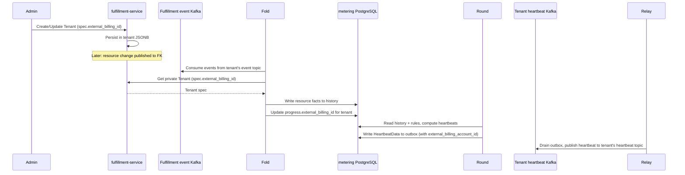

# Tenant External Billing Identity

## Summary

Add an optional, opaque `external_billing_id` to private `TenantSpec`, set through the private Fulfillment API, and have the metering Fold read it from the tenant and store it in the `progress` table so each `HeartbeatData` the Round publishes carries the external billing account identifier. See [PRD](prd.md) for requirements.

## Motivation

OSAC meters tenant consumption and publishes heartbeats to a per-tenant Kafka topic. Downstream billing adapters route those heartbeats using their own account identifiers, which are unrelated to OSAC tenant names. `TenantSpec` has no field for that identifier, and `HeartbeatData` carries only the OSAC `tenant_id`.

This design stores the identifier on the private tenant. The metering Fold reads it from the private Tenant API and records it in `progress`; the Round carries it from `progress` into every `HeartbeatData` it writes.

### Goals

- Add optional `external_billing_id` to private `TenantSpec`, set and read through the private Fulfillment API. [Locked: D2]
- Keep the field out of the generated public schema. [PRD: FR-2]
- Set `HeartbeatData.external_billing_account_id` by reading `progress.external_billing_id`, which the Fold updates from the private Tenant API. [User]
- Apply billing-id changes to later heartbeats only. [PRD: FR-4]
- Store the field in the existing tenant JSONB document. No SQL migration in fulfillment-service.

### Non-Goals

- Console UI, Enclave Wizard, or CLI changes. The field rides the existing tenant manifest, including `osac create -f`. [Locked: D2, D4]
- More than one external billing account per tenant, or a uniqueness constraint.
- Checking that the identifier exists in the external billing system.
- Rewriting heartbeats already published to the tenant's heartbeat Kafka topic.

## Proposal

Two components change. The private Fulfillment API gains `TenantSpec.external_billing_id`. The metering Fold reads that value from the private Tenant API and stores it in `progress`; the Round reads `progress` and sets `HeartbeatData.external_billing_account_id`.

`[(cleanapi.field).private = true]` makes `protoc-gen-cleanapi` omit the field from the public proto. On each fold run for a tenant, the Fold calls the private Tenant API and stores `spec.external_billing_id` in `progress`. The Round reads `progress.external_billing_id` when it builds each heartbeat. A lookup failure leaves `progress` unchanged; the Round uses the last stored value. [User]

### Workflow Description

A Cloud Provider Admin sets `spec.external_billing_id` on create or update of a tenant through the private API (`/api/private/v1/tenants`). The field is optional, at most 256 characters, and has no format check. Private Get and List return it when set. Public Get and List do not define it. [Locked: D2, D3]

`PrivateTenantsServer` uses full object replacement: an Update request replaces the entire `TenantSpec`. Omitting `external_billing_id` from an Update request clears the stored value; setting it to a new value stores that value. A caller that wants to preserve the existing value while changing other fields must re-send `external_billing_id` in the request.

After the value is stored, the metering pipeline propagates it to heartbeats:



On each fold run for a tenant, the Fold calls private Tenant Get, stores `spec.external_billing_id` in `progress.external_billing_id` (clearing it when the tenant has none), and then extracts resource facts into `history`. If the Get fails, the Fold logs at `Warn` and leaves `progress.external_billing_id` unchanged. The Round reads `progress.external_billing_id` for each tenant when it builds a heartbeat and sets `HeartbeatData.external_billing_account_id` when the value is non-empty.

A billing-id change takes effect in the next fold run that processes events for that tenant. Outbox entries already written by the Round are immutable; the Round does not update them after a billing-id change. The first Round tick after the Fold updates `progress` will produce new outbox entries carrying the new id, and the Relay will publish those. Heartbeats already published to the tenant's heartbeat topic stay as they were. [PRD: FR-4]

### API Extensions

- **Private `TenantSpec.external_billing_id`.** Optional string on the existing tenant resource. Create, Update, Get, and List on `/api/private/v1/tenants` gain the field. The public tenant messages are unchanged because `proto/public/` is generated.
- **`HeartbeatData.external_billing_account_id`.** Optional JSON field on the metering heartbeat payload. Present when `progress.external_billing_id` is non-empty for that tenant. Absent when it is not.

## UX Alignment

No UI mapping. The field is private, and console UI is out of scope. [Locked: D2]

### Implementation Details/Notes/Constraints

Add field 3 on `TenantSpec` in `proto/private/osac/private/v1/tenant_type.proto`, after the existing public fields:

```protobuf
message TenantSpec {
  repeated string domains = 1;
  SecretLocalReference break_glass_credentials_secret = 2;

  // Opaque identifier for this tenant's account in the external billing
  // system. Optional. Provider-controlled. Omitted from the public API.
  optional string external_billing_id = 3
    [(cleanapi.field).private = true,
     (buf.validate.field).string.max_len = 256];
}
```

Regenerate with `make -C proto generate` and lint with `buf lint`. Do not edit `proto/public/`.

`PrivateTenantsServer` persists the proto as JSONB through `GenericServer` and `GenericDAO`. No server change and no SQL migration. The public `GenericMapper` copies fields by name; the generated public `TenantSpec` has no `external_billing_id`, so the value is never copied to a public response. The existing protovalidate interceptor enforces the 256-character limit on Create and Update.

In metering, changes touch three files:

**`osac-metering/metering-service/internal/database/schema.go`** — add `external_billing_id TEXT` as a nullable column to the `progress` table in `schemaSQL`. One row per tenant; `NULL` means no billing id has been observed yet for that tenant.

**`osac-metering/metering-service/internal/fold/fold.go`** — at the start of `RunTenant`'s fold loop, call `TenantsClient.Get` for that tenant. If the call succeeds, call `SetTenantBillingID(ctx, tx, tenant, value)` which upserts `progress.external_billing_id` (clears it when the tenant has no `external_billing_id`). If the call fails, log at `Warn` (`failed to look up tenant billing ID`, with `tenant` and `error`) and leave `progress.external_billing_id` unchanged.

**`osac-metering/schema/heartbeat.go`** — add the field to `HeartbeatData`:

```go
ExternalBillingAccountID *string `json:"external_billing_account_id,omitempty"`
```

The Round reads `progress.external_billing_id` alongside the other per-tenant progress fields and passes it to the heartbeat builder (`heartbeat/event.go`). The builder sets `data.ExternalBillingAccountID` when the value is non-empty.

The field is carried on `HeartbeatData` and published to the tenant's heartbeat topic, where an adapter for a billing system that needs the OSAC→account mapping can read it. It is deliberately excluded from `heartbeatDataFields`, so the m360 adapter — which maintains its own account mapping — never receives it. `schema/heartbeat_test.go`'s field-list assertion is widened to skip it, alongside `usage` and `billing_dimensions`.

### Security Considerations

The private annotation is the access boundary. Public clients have no field to send or receive. The value is an account reference with the same sensitivity as the tenant name, and the only new validation is the 256-character limit. [PRD: FR-2]

### Failure Handling and Recovery

A value longer than 256 characters is rejected on Create and Update. Omitting the field on Update clears the stored value; subsequent heartbeats omit `external_billing_account_id`. If the Fold's Tenant Get fails, `progress.external_billing_id` is left unchanged and the next fold run retries the lookup. Heartbeats continue to use the last known value during the failure window. This is a deliberate tradeoff: blocking heartbeat generation on a lookup failure would stop billing reporting entirely, which is worse than a bounded period of stale attribution. The staleness window is bounded by the next successful fold run. A changed id takes effect in the next fold run; heartbeats already sent stay as they were. [PRD: FR-4]

### RBAC / Tenancy

No new RBAC. Cloud Provider Admins use the private Tenant API. The public schema omits the field.

### Observability and Monitoring

No new metrics or alerts. [Locked: D3] A failed tenant lookup is logged at `Warn` with the message `failed to look up tenant billing ID`. It does not include the tenant id or billing id in the message.

### Risks and Mitigations

The new JSON key is omitted when unset, so existing adapters ignore it. m360 never receives it because the field is excluded from `heartbeatDataFields`.

### Drawbacks

Every fold run for a tenant calls the private Tenant API once. That extra RPC is accepted because fold runs are per-tenant and infrequent, and the next fold run after a billing-id change propagates the new id. [User]

## Alternatives (Not Implemented)

| Decision | Alternative | Why it was rejected |
|----------|-------------|---------------------|
| Enrich in metering Fold | Each adapter calls the private Tenant API | Adapters for billing systems without an existing OSAC integration can read the field directly from the heartbeat topic. Adapters such as m360 that already maintain their own OSAC→account mapping exclude the field and are unaffected. Pushing the lookup into every adapter duplicates the credential and API connection requirements. |
| Field on `HeartbeatData` | CloudEvent extension attribute only | Receivers are not required to forward extension attributes, so a broker can strip the id. Adapters already read `HeartbeatData`. |
| Private spec field | `metadata.labels` entry | Labels are on the public API and are caller-writable, which breaks FR-2. |
| Read the tenant on each fold run | In-process cache of the billing id | A cache needs invalidation on tenant update and can use a stale id after a change. Fold runs are per-tenant and infrequent enough that the Get is the smaller design. [User] |

## Test Plan

Test the private field and the heartbeat payload together. Create and update a tenant with and without `external_billing_id` on the private API, and confirm a public Get omits it. Run a fold for that tenant and confirm `progress.external_billing_id` matches the tenant's current value, including the next fold run after an update, and is cleared when the tenant has none. Confirm the Round sets `HeartbeatData.external_billing_account_id` from `progress` when non-empty and omits it when empty. Confirm the m360 payload contains no `external_billing_account_id` even when the tenant has a billing id set. A value longer than 256 characters is rejected. A Tenant Get failure in the Fold leaves `progress.external_billing_id` unchanged and heartbeats continue to use the last stored value.

Update semantics: confirm that omitting `external_billing_id` from an Update request clears the stored value (subsequent Get returns no field; subsequent heartbeats omit `external_billing_account_id`). Confirm that a caller who sends the same value on Update preserves it. Confirm that a caller who changes the value on Update stores the new value and that the next fold run propagates it.

## Graduation Criteria

Not targeted at a release yet.

## Upgrade / Downgrade Strategy

The field is optional. Upgrade needs no migration in fulfillment-service. Downgrade leaves the value in the tenant JSONB document and omits it from the API and from new heartbeats. The stored value is still there after a later upgrade.

## Version Skew Strategy

An older fulfillment-service ignores the field on input and omits it on output. An older metering build omits `HeartbeatData.external_billing_account_id`. If metering is upgraded first, the Fold's Tenant Get returns no billing id until fulfillment-service is upgraded, and heartbeats published in that window omit the field.

## Support Procedures

If heartbeats for a tenant lack `external_billing_account_id`, read the tenant on the private API. A `failed to look up tenant billing ID` warning means the Fold's Get failed. The next successful fold run updates `progress` and subsequent heartbeats carry the id. Heartbeats already published are not replayed.

## Infrastructure Needed

None.

---

## Provenance

Authored: revise @ design 0.11.5 - a58bdf7, workspace main @ f0a8211
Phases: draft, revise, revise, revise, revise

<!-- ai-workflow-provenance:{"schema_version":1,"provenance_kind":"session","workflow":"design","workflow_version":"0.11.5","ai_workflows":"a58bdf7","source_repo":"f0a8211","source_repo_branch":"main","commits_behind_main":0,"commits_ahead_main":0,"main_ref":"main","phases":["draft","revise","revise","revise","revise"],"authoring_modes":["skill"],"context_changed":false,"origin_untracked":false} -->
